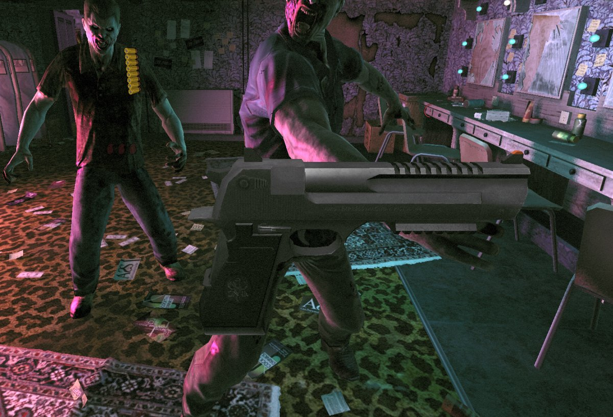
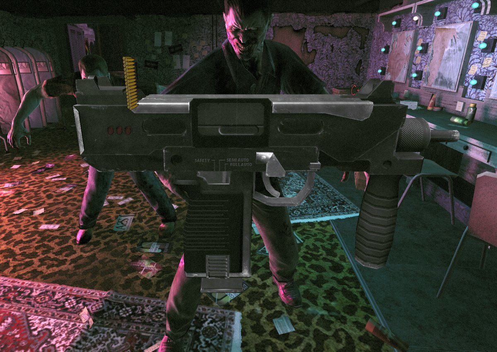
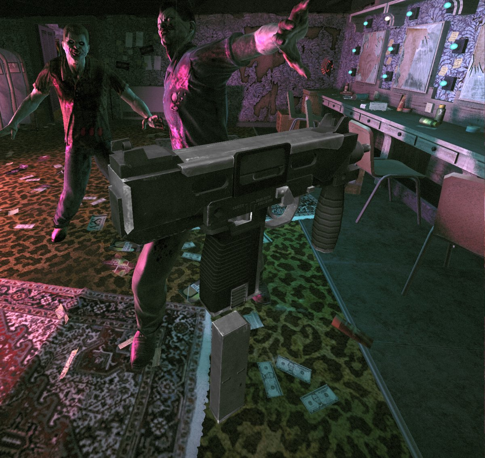

# House of the Dead: Overkill VR

Play *House of the Dead: Overkill* in VR: stand in the game with head tracking and shoot zombies
with a gun that fires where you point it.

## What it is

A mod for the **House of the Dead: Overkill** mode that comes with *The Typing of the Dead:
Overkill* on Steam. With it, the on-rails shooter plays in a PC VR headset:

- **Stereo 3D with head tracking.** The game still carries you along its rail; you can look and
  lean around wherever it takes you.
- **Your controller is the gun.** Shots go where the barrel points, from where your hand is, so
  you can shoot from the hip or with the gun held out to the side.
- **The game's own guns in your hand.** The weapon you have selected (Magnum, SMG, shotguns and
  the rest) is drawn in your hand and changes when you switch. On a reload the magazine drops out
  and slides back in.
- **The HUD** (health, score, ammo) floats on a panel in front of you. Menus, the loadout screen,
  cutscenes, the pause menu and the death screen appear on a big flat screen in front of you; you
  point at them and pull the trigger.

## Status: early pre-release

This is an early pre-release (0.1.x). It has had one short session in a real headset (a Steam
Frame): stereo, head tracking, the gun and the menus looked good, and the comfort settings in 0.1.2
came out of it. Most testing so far was on a PC without a headset, against a stand-in for SteamVR
(that is where the pictures on this page come from). Expect rough edges: the aim may be a little
off in fast turns, the gun may sit oddly in your hand, menus may be hard to read, and other
headsets haven't been tried.

If you try it, please say how it went in
[GitHub issues](https://github.com/idio-sync/hotd-overkill-vr/issues), good or bad, and attach the
log `hovr\hovr.log` from the game's folder.

## What you need

- *The Typing of the Dead: Overkill* **on Steam, Windows**: the current Steam version (build
  569304). Copies of its `HOTD_NG.exe` changed by other patchers or mods (a 4 GB / Large Address
  Aware patch, for example) work as long as they leave the parts the mod uses alone. The mod
  checks this itself at every start: with another version, or a change where it hooks in, it does
  nothing and the game plays normally, and `hovr\hovr.log` says which part differs.
- **SteamVR** and a PC VR headset with **two tracked motion controllers**. It is being designed for
  the Steam Frame; other SteamVR headsets should work.
- No game files are included; you need your own copy of the game.

## Install

1. Download `hotd-overkill-vr-<version>.zip` from the
   [Releases](https://github.com/idio-sync/hotd-overkill-vr/releases) page.
2. Close the game. In Steam, right-click *The Typing of the Dead: Overkill* > **Manage** >
   **Browse local files**. This opens the game's folder, the one with `HOTD_NG.exe` (usually
   `C:\Program Files (x86)\Steam\steamapps\common\Typing of the Dead Overkill`).
3. Extract the zip into that folder, so that `XINPUT1_3.dll` and `openvr_api.dll` sit next to
   `HOTD_NG.exe`.

> **Already using another mod?** If the folder already has an `XINPUT1_3.dll`, it belongs to
> another mod. Don't overwrite it: the two mods can't be installed together.

To update, extract a newer zip over the old files. Your settings are kept.

## Playing

1. Turn on your controllers and **start SteamVR first**.
2. Start the game from Steam as usual.
3. On the main menu, choose **The House of the Dead: Overkill** (the typing modes are not supported
   in VR), then Story mode, a level and Start.

Point at menu items with the gun hand and pull the trigger to select. To play without VR for one
session, hold **Shift** while the game starts.

### Controls

The gun is the right controller (set `hand=left` for left-handed play; see Settings).

| Controller | Action |
|---|---|
| Trigger | Fire (hold for automatic weapons); select in menus |
| A (or X) | Reload |
| B (or Y) | Switch weapon |
| Grip | Throw a grenade |
| B/Y or A/X on the other hand | Pause menu; skips cutscenes |
| Gun hand's stick, pressed and held for 1 second | Recentre the view to where you are facing |

### What you'll see

- During gameplay, the level all around you in 3D, with the HUD panel about 1.5 m in front.
- Your current weapon in your hand. When you reload, its magazine drops out of the grip and
  slides back.
- Menus, cutscenes, the pause menu and the death screen on a large flat screen about 3 m away.
- After a pause, a cutscene or a continue, the view turns to face where you are looking.

### Comfort

The game moves your view in ways that feel bad in a headset, so these are off by default:

- **Camera shake** when you are hit (the game swings the view by up to about 30 degrees).
- **Edge panning**: the game turns the view when the cursor reaches the edge of the screen. In VR
  that would happen whenever you point away from where you look, so it is turned off.
- **The game's own reload animation**, which would put a second gun in front of your face.

The rail itself can move you fast, so three comfort settings are **on by default** (change them
in `hovr\hovr.ini`, see Settings):

- **Vignette** (`comfort_vignette`, `0.6`): the edges of the view darken while the rail turns or
  moves quickly, and clear again when it slows down. `1` makes it stronger, `0` turns it off.
- **Smoother turns** (`comfort_smooth_ms`, `150`): the view eases into and out of the rail's
  turns instead of snapping. `0` turns it off. Aiming is unaffected: shots still go where the gun
  points.
- **Level horizon** (`comfort_level`, `1`): the rail camera's sideways tilt is removed. `2` also
  removes its up/down tilt, `0` keeps the game's.

You can look around about 35 degrees either side of the direction the rail is facing. Further
than that, parts of the level may be missing (the game only draws what it expects you to see).

## Settings

The settings are in `hovr\hovr.ini` in the game's folder. The mod writes this file the first time
it starts, with a short comment on each setting. Change a value, save, and start the game again.
To get the defaults back, delete the file.

The most useful ones, in the `[vr]` section:

| Setting | Default | What it does |
|---|---|---|
| `mode` | `openvr` | `openvr` = VR through SteamVR; `off` = always play without VR |
| `eye_scale` | `1.0` | Rendering resolution (sharpness). Lower it (e.g. `0.8`) if the game stutters |
| `hand` | `right` | The hand that holds the gun: `right` or `left` |
| `hand_pitch` | `0` | Degrees to raise the aim if shots land consistently below where the barrel points (negative if above) |
| `gun_grip` | `0,-0.03,0.05` | Where the gun sits in your hand, in metres: right, up, back |
| `gun_scale` | `1.0` | Size of the gun in your hand |
| `haptics` | `1.0` | Strength of the vibration: a thump per shot (per weapon), a tick on a hit, clicks when empty and on reloads (`0` = off) |
| `muzzle_flash` | `1` | `0` turns off the flash at the muzzle on each shot |
| `recoil` | `1.0` | How hard the gun kicks in your hand on each shot (`0` = off; the aim never moves) |
| `marker` | `0` | `1` shows a small red dot where your shots will land |
| `crosshair` | `0` | `1` shows the game's crosshair on the HUD panel |
| `camera_shake` | `0` | `1` brings back the game's camera shake when you are hit |
| `comfort_vignette` | `0.6` | Darken the view's edges while the rail moves fast (`0` = off, `1` = strongest) |
| `comfort_smooth_ms` | `150` | Ease into and out of the rail's turns (`0` = off) |
| `comfort_level` | `1` | Level horizon: `0` = as the game, `1` = no sideways tilt, `2` = no tilt at all |

Every other setting (panel sizes and distances, button mapping, per-weapon tweaks, the other
comfort switches) is described in [docs/SETTINGS.md](docs/SETTINGS.md)
([online](https://github.com/idio-sync/hotd-overkill-vr/blob/main/docs/SETTINGS.md)).

## Troubleshooting and known issues

- **Something goes wrong**: close the game and start it again holding **Shift** to play without
  VR. Then please open an issue with `hovr\hovr.log` attached.
- **The game crashes**: please open an issue with `hovr\hovr.log` and `hovr\crash.dmp` (written
  when the game crashes: parts of the game's memory that show where it crashed, which can include
  file paths with your Windows user name). Say which graphics card and headset you use, and the resolution and
  anti-aliasing setting in the game's options.
- **The game starts flat and never goes into VR, and `hovr\hovr.log` says "not the supported
  build"**: the mod switched itself off because `HOTD_NG.exe` is another version, or a copy that
  another mod, fix or patcher changed in a place the mod hooks into. The log lists each such place
  (`anchor "..." at 0x...: expected ..., found ...`) and says whether the exe is a changed copy of
  the supported build or a different build. For a changed copy: undo that other patch, or in
  Steam right-click the game → Properties → Installed Files → **Verify integrity of game files**,
  then try again. If that doesn't help, please open an issue with the log.
- **The log says "patched copy of the supported build - compatible"**: your exe was changed by
  something else (the log names which parts, such as "PE headers" for a 4 GB patch), but nothing
  the mod uses, so VR is on. If something misbehaves, try the unchanged exe (Verify integrity)
  before reporting it, and mention the patch in the report.
- **Virtual Desktop, Quest or other non-SteamVR headsets**: the mod talks to SteamVR, so start the
  game through SteamVR (in Virtual Desktop, launch SteamVR first). Virtual Desktop's own OpenXR
  runtime on its own won't work.
- **Shots land above or below where the gun points**: adjust `hand_pitch`. If they land to the left
  or right, that's a bug; please report it.
- **The game stutters or SteamVR shows reprojection**: set `eye_scale=0.8`, or run the headset at
  90 Hz.
- **The game pauses or stops responding to the controllers** while its desktop window isn't in
  front: set `keep_active=1`.
- **Small menu text is hard to read** on the flat screen: make it bigger with `screen_width` or
  bring it closer with `screen_distance`.
- The pause and death screens appear where the rail is facing, not where you are looking.
- **No gun in your hand in the mini-games** (Stayin' Alive, Victim Support, Money Shot II): the
  game loads no first-person weapon models there, so only the aim works (`marker=1` shows the red
  dot). The story levels have them. If a story level shows no gun, please report it with
  `hovr\hovr.log`: its `gun model:` lines say what was missing.
- The crossbow has no reload animation in your hand (the hand cannon's cylinder swings out and
  the pump's forend racks instead of a magazine dropping).
- Only player 1 is supported; no co-op.

## Uninstall

Delete `XINPUT1_3.dll`, `openvr_api.dll` and the `hovr` folder from the game's folder (and the
zip's `README.md`, `LICENSE` and `LICENSES.txt`). Nothing else in the game folder is changed, and
the mod never touches your save.

## Credits and licence

- The mod is released under the MIT licence (see [LICENSE](LICENSE)).
- `openvr_api.dll` is Valve's OpenVR SDK, under its BSD 3-clause licence (included in the zip's
  `LICENSES.txt`).
- Not affiliated with or endorsed by SEGA or Valve. *The Typing of the Dead: Overkill* and *House
  of the Dead: Overkill* belong to their owners; no game files are included.

Changes in each release: [CHANGELOG.md](CHANGELOG.md).

## Building and contributing

How the mod works, how to build it, the test tools (including the stand-in SteamVR runtime used
for the pictures above) and how releases are made: [docs/DEVELOPMENT.md](docs/DEVELOPMENT.md).
